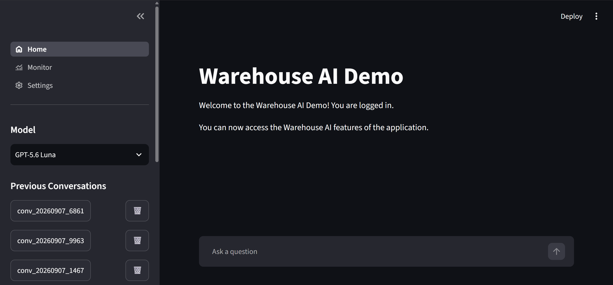
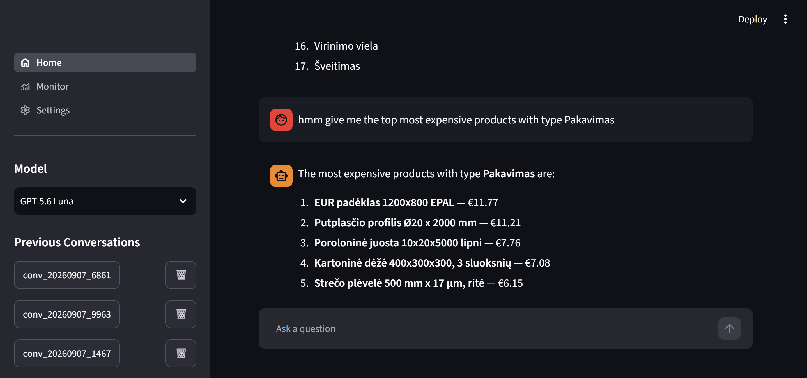
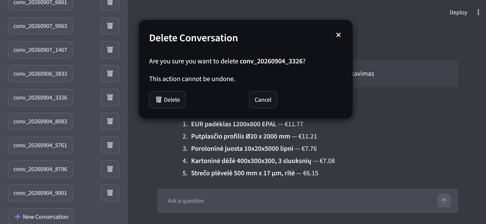
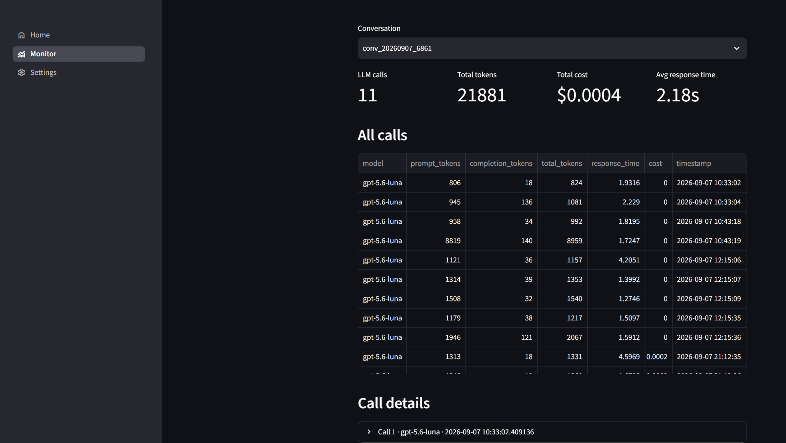
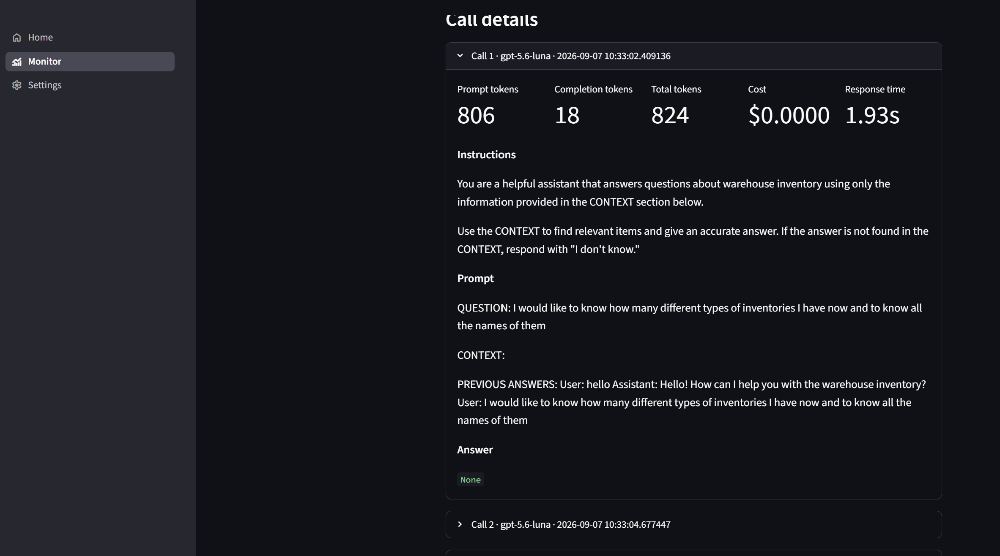
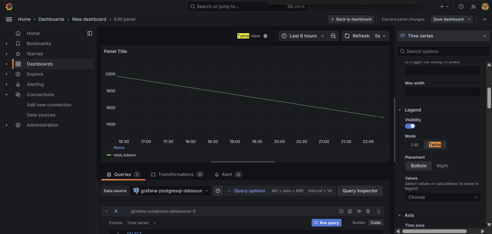

# Warehouse AI Demo

[](https://www.python.org/downloads/)
[](https://www.docker.com/)
[](https://streamlit.io/)

An end-to-end LLM agent application that answers natural-language questions
about warehouse inventory — stock levels, pricing, categories, locations —
grounded in real inventory data instead of a spreadsheet employees have to
search manually.

## Screenshots

Initial page


Already saved conversation like chatgpt/claude


Trying to delete an old conversation


Monitoring per conversation id and user

 
Detailed statistics per turn


## 🎯 Features

- **🛠️ Tool-calling agent**: the LLM decides for itself when to search for
  items (`search`) versus when to filter/rank/count/aggregate over the
  whole dataset (`query_data`) — not a fixed retrieve-then-generate pipeline.
- **🔍 Keyword search** over inventory items via `minsearch`, boosted on
  item name.
- **📊 Structured querying**: exact-match filtering, numeric range filters,
  ranking ("most expensive"), distinct-value listing ("what types exist"),
  and exact counts — all over the full dataset, not just a capped top-N.
- **🧬 Vector search pipeline**: inventory records are embedded
  (`intfloat/multilingual-e5-base`, chosen for the Lithuanian-language item
  names) and ingested into Milvus; semantic-search integration into the
  live chat is in progress.
- **📈 Per-conversation monitoring**: every LLM call is logged to Postgres
  with token counts, cost, and response time, viewable in-app.
- **🖥️ Multi-page Streamlit interface**: chat, authentication, monitoring
  dashboard, and settings.
- **🐳 Fully containerized**: the whole stack — app, Postgres, Milvus (with
  etcd/Minio), Grafana, pgAdmin, and Attu — runs via Docker Compose.

## 🏗️ Architecture

```
┌──────────────────┐    ┌────────────────────┐    ┌──────────────────┐
│  data/data.json  │───▶│  Ingestion          │───▶│  minsearch index  │
│ (inventory data) │    │ (1_check_db.py)     │    │  Milvus (vectors) │
└──────────────────┘    └────────────────────┘    └────────┬──────────┘
                                                             │
┌──────────────────┐    ┌────────────────────┐              │
│  Streamlit UI    │◀──▶│  RAGClient          │◀─────────────┘
│  (pages/home.py) │    │  tool-calling loop  │
└──────────────────┘    │  (llm/rag/rag.py)   │
         │              └──────────┬──────────┘
         │                         │
         ▼                         ▼
┌──────────────────┐    ┌────────────────────┐
│    Postgres       │◀──│  search / query_data │
│ (auth, history,   │    │  tools (llm/tools,   │
│  llm_call_records)│    │  llm/functions)      │
└──────────────────┘    └────────────────────┘
         │
         ▼
┌──────────────────┐
│ monitor.py /      │
│ Grafana dashboard │
└──────────────────┘
```

## 🚀 Quick Start

1. **Clone the repository**
   ```bash
   git clone <repository-url>
   cd llm_zoomcamp_project
   ```

2. **Set up environment variables**
   ```bash
   cp .env.example .env
   # Edit .env and add your OpenAI API key, and adjust any other defaults
   ```

3. **Start the stack**
   ```bash
   ./0_runme.sh
   ```

   #### Alternative: run the app locally with `uv` instead of in Docker

   Useful while developing, since code changes are picked up instantly
   without rebuilding the container. Postgres and Milvus still need to be
   running (they don't have a local-only alternative), so start just the
   backing services with Docker, then run the app itself with `uv`:

   ```bash
   docker compose up -d postgres milvus etcd minio
   uv sync
   uv run streamlit run pages/main.py
   ```

   `pages/db.py` and the Milvus ingest script already default to
   `localhost` when `POSTGRES_HOST`/`MILVUS_HOST` aren't set, so this works
   without extra configuration as long as `.env` is set up (Step 2).

4. **Initialize the database and vector index**
   ```bash
   ./1_runme.sh
   ```
   Applies the Postgres schema and ingests `data/data.json` into Milvus.
   Re-run any time you want to reset the schema or re-ingest the data.

   If you're running the app locally with `uv` (see above) instead of in
   Docker, `1_runme.sh` won't work as-is — it execs into the `app`
   container, which isn't running in that setup. Use this instead:
   ```bash
   uv run python db_queries/1_check_db.py
   ```

5. **Access the interfaces**
   - Main application: http://localhost:8501
   - Monitoring dashboard (Grafana): http://localhost:3000
   - Postgres admin (pgAdmin): http://localhost:5050
   - Milvus admin (Attu): http://localhost:8000

## 📁 Project Structure

```
llm_zoomcamp_project/
├── pages/                     # Streamlit pages
│   ├── main.py                #   router / navigation
│   ├── home.py                #   chat interface
│   ├── login.py, signup.py    #   authentication
│   ├── monitor.py             #   per-conversation LLM call stats
│   ├── settings.py
│   └── db.py                  #   Postgres connection config
├── llm/
│   ├── rag/
│   │   └── rag.py             #   RAGClient: tool-calling loop, search,
│   │                          #   query_data, cost/token logging
│   ├── tools/tools.py         #   OpenAI tool schemas (search, query_data)
│   ├── functions/functions.py #   standalone search implementation
│   └── eval/                  #   retrieval + answer evaluation (WIP)
├── db_queries/                # Postgres schema + Milvus ingest script
├── data/data.json             # warehouse inventory dataset
├── grafana/provisioning/      # Grafana datasource config
├── docker-compose.yml         # app + Postgres + Milvus + Grafana + admin UIs
├── Dockerfile
├── 0_runme.sh                 # start the stack
├── 1_runme.sh                 # apply schema + ingest data
└── pyproject.toml / uv.lock   # dependencies (managed with uv)
```

## 📚 Usage Guide

1. Open the app at http://localhost:8501, sign up, and log in.
2. Ask a question about the inventory in plain language — the agent decides
   whether to search for similar items or query the full dataset for
   counts/rankings/categories.
3. Continue the conversation — follow-up questions ("give me more details
   on those") are resolved by the model itself, since it has the earlier
   turns in context when deciding what to search for next.
4. Open the **Monitor** page to see token usage, cost, and response time
   for every LLM call in a given conversation.

## 💡 Example questions you can ask

- "How many products do we have of type Vamzdis?" *(exact count over the
  whole dataset, via `query_data`)*
- "What types of items exist in the warehouse?" *(distinct-value listing)*
- "What are the 5 most expensive items?" *(ranking)*
- "Show me items priced between 20 and 500." *(numeric range filter)*
- "Find items like a rectangular pipe." *(fuzzy keyword search)*

## 🔧 Configuration

Key environment variables (see `.env.example`):

```bash
# LLM
OPENAI_API_KEY=your_openai_api_key_here

# Postgres
POSTGRES_USER=llm_user
POSTGRES_PASSWORD=llm_password
POSTGRES_DB=llm_zoomcamp
POSTGRES_PORT=5432

# Grafana / pgAdmin
GRAFANA_ADMIN_USER=admin
GRAFANA_ADMIN_PASSWORD=admin
PGADMIN_DEFAULT_EMAIL=admin@admin.com
PGADMIN_DEFAULT_PASSWORD=admin
```

`MILVUS_HOST`/`MILVUS_PORT` are set directly in `docker-compose.yml` for
inter-container networking and don't need to be in `.env`.

## 🛠️ Tools available to the agent

- **`search`**: fuzzy keyword match against item name, measurements, and
  type — for "find items like X" questions.
- **`query_data`**: operates over the full dataset rather than a capped
  top-N — supports exact-match filtering, numeric ranges, ranking,
  distinct-value listing, and exact counts.

## 📈 Monitoring

Every LLM call made during a conversation is logged to the
`llm_call_records` Postgres table with model, prompt tokens, completion
tokens, total tokens, cost, and response time. The **Monitor** page in the
app lets you pick a conversation and see both a summary table and
per-call detail. Grafana is also provisioned in the stack for
dashboard-based monitoring.



## License

<!-- TODO: choose and add a license -->

## 🙏 Acknowledgments

- [**LLM Zoomcamp Course**](https://github.com/DataTalksClub/llm-zoomcamp)
- [**DataTalks.Club**](https://datatalks.club/)
- OpenAI for the LLM API
- [minsearch](https://github.com/alexeygrigorev/minsearch) for keyword search
- [Milvus](https://milvus.io/) for vector search
- Hugging Face / `sentence-transformers` for the embedding model
- Streamlit for the web interface
