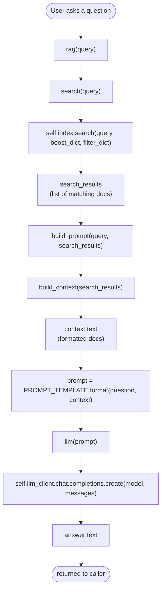

# Workflow

So the following mental model is made for me understand the situation
of a RAG.

The class on rag.py contains the 5 functions in which they run in chain.

## Call order

1. **`rag(query)`** — entry point. Orchestrates the other four and returns the final answer.
2. **`search(query)`** — asks the minsearch `Index` for the most relevant documents (boosted on `name`, optionally filtered).
3. **`build_prompt(query, search_results)`** — builds the final prompt string sent to the LLM. Internally calls `build_context()`.
4. **`build_context(search_results)`** — formats the raw search-result dicts into one block of readable text. Called *by* `build_prompt`, not directly by `rag`.
5. **`llm(prompt)`** — sends the prompt to the OpenAI client and extracts the answer text.

Note: `build_context` isn't a sibling step — it's nested inside `build_prompt`. The real call depth is `rag → search`, `rag → build_prompt → build_context`, `rag → llm`.

## Flow diagram

